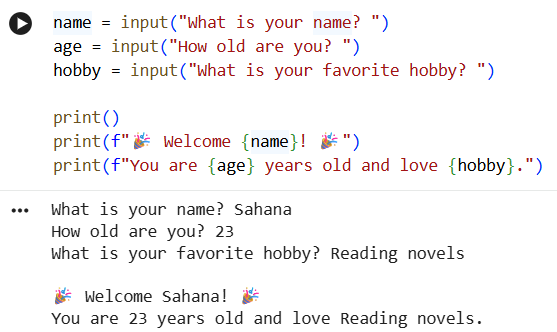

# Personal Introduction Program

## Project Overview
A simple Python program that asks the user for their name, age and hobby, and then shows a friendly welcome message.

## Setup Instructions
1. Install Python 3 from python.org (or use Google Colab).
2. Download personal_intro.py from this repository.
3. Run it with: python personal_intro.py

## Code Structure
- personal_intro.py : the main program
- requirements.txt : no libraries needed
- screenshot.png : picture of the program running

## Visual Documentation

## Technical Details
- input() takes the name, age and hobby from the user.
- Variables store the answers.
- print() with f-strings shows the welcome message.

## Testing Evidence
Test input: Sahana, 23, Reading novels
Output: Welcome Sahana! You are 23 years old and love Reading novels.
The output matched the expected result.

## What I Learned
I learned how to run Python, take user input, store it in variables, and show a message using f-strings. I also learned how to upload a project to GitHub.
